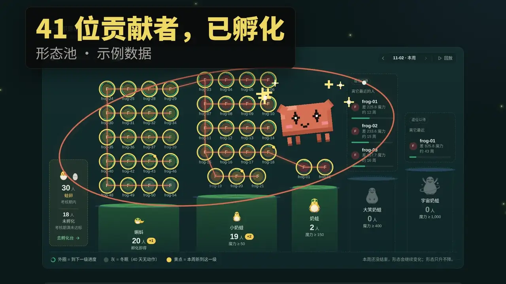

# 奶蛙宇宙贡献度看板

[](#视频介绍)

https://nwverse.github.io/contribution/

页面展示上传脚本生成的数据快照：nwverse 贡献者的人维度贡献度。页面和数据公开可见，数据范围约束见 [AGENTS.md](AGENTS.md)。

## 视频介绍

https://github.com/user-attachments/assets/8727572c-4e0c-47b3-9ad6-5f0306008794

[下载高清视频与字幕](https://github.com/nwverse/contribution/releases/tag/promo-v1)

## 更新数据

```bash
node scripts/upload.mjs
```

脚本完整拉取组织数据（约 160 点 GraphQL 额度、390 次 REST 请求，约六分钟），在本机计算贡献度，再把 `scripts/upload.mjs` 中 `SITE_FILES` 列出的站点文件（六个页面、`engine.js`、`assets/` 下的脚本与 `tokens.css`、`.nojekyll`、图标和宣传动图）与 `data/board.json` 一次提交到 `gh-pages`。内容没变时不提交，失败时退出码非 0。

加 `--dry-run` 只拉取和计算，结果写到 `dist/board.json`，不发布。

| 环境变量 | 用途 | 默认值 |
|---|---|---|
| `GITHUB_TOKEN` | 读取组织数据 | `gh auth token` 的输出 |
| `PUBLISH_TOKEN` | 写入 `gh-pages`，必须属于仓库管理员 | 同 `GITHUB_TOKEN` |
| `ORG` | 统计的组织 | `nwverse` |
| `PAGES_REPO` | 发布仓库 | `nwverse/contribution` |
| `PAGES_BRANCH` | 发布分支 | `gh-pages` |

token 权限：

- `GITHUB_TOKEN`：classic token 需要 `repo`、`read:org`；fine-grained token 需要 nwverse 全部仓库的 Contents、Issues、Pull requests 只读，以及组织 Members 只读。
- `PUBLISH_TOKEN`：fine-grained token 只授权本仓库的 Contents 读写即可。

上传脚本依赖 Node.js 18 及以上，无第三方依赖；`package.json` 只声明端到端测试用的 Playwright。

## 修改规则或页面

计分规则在 `engine.js` 的 `RULES`。页面有六个：`index.html`（本周）、`ranking.html`、`profile.html`、`hatchery.html`、`pond.html`、`rules.html`，共用 `assets/` 下的设计系统。改动通过 PR 合入 `main` 后，下次运行上传脚本时随数据一起发布。

每周 PR 原始分（含模型系数）与协作原始分分别递减计分，上限取 `RULES.weeklyScoreCaps`，两项互不稀释。上传脚本会按当前规则重算历史各周，因此规则调整也可能改变累计魔力、排名和形态。

## 本地预览与测试

```bash
node scripts/upload.mjs --dry-run   # 生成 dist/board.json
node scripts/serve.mjs              # http://127.0.0.1:8080/
```

`serve.mjs` 依次取 `BOARD_FILE`、`data/board.json`、`dist/board.json` 作为页面数据。

`npm test` 运行 `test:engine` 和 `test:upload`，与 CI 运行的用例相同，无需安装依赖：前者用合成数据验证计分行为，后者用模拟的 GitHub 响应运行上传脚本的 `--dry-run`，不访问网络。端到端测试用脱敏的 `tests/fixtures/board.json`，不读取组织数据：

```bash
npm ci
npm test
npx playwright install chromium
npm run test:e2e
```

测试数据需要更新时：`node tests/fixtures/anonymize.mjs dist/board.json > tests/fixtures/board.json`。

## CI

CI checks the scoring engine, upload script and page script syntax, runs scoring and upload behavior tests, and runs
the Playwright end-to-end tests against the anonymized fixture, without reading
or publishing organization data. `CI_LINUX_RUNNER` selects the HomeLab executor
only for trusted default-branch runs. Pull requests use hosted runners.
